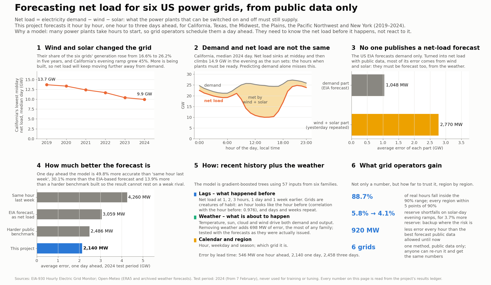

# Net-load forecasting and flexibility planning for high-renewable grids

SIADS 696 Milestone II · Master of Applied Data Science, University of Michigan School of Information
Authors: Alan Mossinger · Eric Londo · Eran Abeysekera — Mentor: Erik Lang

**Net load** is electricity demand minus wind and solar output: what the controllable power plants must still
supply. This project forecasts it hour by hour, 1 to 72 hours ahead, for six US balancing authorities
(California CISO, Texas ERCO, MISO, the Plains SWPP, Bonneville BPAT, New York NYIS), 2019–2024, from public data
only, and turns the forecast into a calibrated uncertainty band an operator could size reserve from.



## Results (held-out 2024 data, never used for training or tuning)

| Question | Answer |
|---|---|
| Q1. Can net load be forecast a day ahead from public data, better than the best public alternative? | Yes. Day-ahead error **2,140 MW** (gradient-boosted trees), **49.8%** better than seasonal naive, **30.1%** better than the EIA demand forecast turned into net load, and **13.9%** better than a strengthened version of that benchmark. |
| Q2. How far can the forecast be trusted, hour by hour and region by region? | A conformal 90% band conditioned on region covers **88.7%** of real hours, with every region within 5 points of 90%. |
| Q3. What recurring daily shapes does net load fall into, and do they matter? | Three regimes (k-means, k = 3), stable under resampling (ARI **0.996**). Used to place reserve, they cut shortfalls on duck-curve evenings from **5.8%** to **4.1%** of hours for 3.7% more capacity. |

A difference-in-differences and a propensity-matching design both point the same way on whether more solar
causes steeper evening ramps, but neither can identify the size; the report says so rather than claim one.

## Report

- [`reports/Milestone_II_Final_Report.pdf`](reports/Milestone_II_Final_Report.pdf) — the final report (19 pages).
- The notebooks are the full record: every analysis, every figure (`reports/figures/`), and the text that reads it.

## Repository

```
notebooks/        00_data → 08_final_results, run in order; each stores its results in data/processed/results.json
src/              the code the notebooks import
  config.py         paths, zones, dates, horizons, the holdout cut, feature lists
  sources.py        EIA-930, Open-Meteo weather and reserve-price clients (cached under data/raw/)
  data.py           cleaning contract, the net-load target, the panel; synthetic panel for tests
  features.py       sklearn feature pipeline, chronological CV split, clustering pipeline
  models.py         benchmarks (seasonal naive, EIA composite), the linear rung, shared training frames
  evaluation.py     skill, paired tests, learning curves, per-region skill
  uncertainty.py    quantiles, conformal calibration (pooled and per region), interval scores
  causal.py         DAG and adjustment sets, difference-in-differences, propensity matching
  explain.py        permutation importance, ALE, worst-day attribution
  reserve.py        reserve sizing from the calibrated band, by regime and hour
  results.py        the results ledger (data/processed/results.json)
tests/            leakage, data contract, features, models, evaluation, calibration, causal, README numbers
report_figures/   redraws the report figures from results.json (`make figures`)
data/             raw pulls, processed panel and results — see data/README.md
docs/             methodology, data dictionary, decision log, causal adjustment set
```

## Reproduce

Python 3.12 and `make` (on Windows, Git Bash). No API key is needed: the raw pulls are committed in `data/raw/`.

```bash
make setup        # .venv from requirements.lock.txt + the "electricity-grid" Jupyter kernel
make test         # unit tests, about a minute
make run          # notebooks 00..08 in order, about 4 hours (04 alone about 2 hours)
make run FROM=05  # from notebook 05 onward
make figures      # report figures from data/processed/results.json
```

- **Check instead of overwrite.** With `NETLOAD_RESULTS_READONLY=1` set, every result a notebook stores is compared
  with the committed `results.json` and any difference raises, so a run proves the numbers instead of replacing them.
- **If a run stalls on Windows** (a joblib worker pool can deadlock late in a long notebook), each cell gives up
  after 4 hours; run it again with fewer workers: `make run FROM=04 NJOBS=4`. Results do not depend on it.
- To pull fresh data, copy `.env.example` to `.env` and add a free EIA key (https://www.eia.gov/opendata/).

## How the evaluation is kept honest

1. **One chronological holdout.** Everything after 2024-02-06 23:00 is held out and scored once; all tuning uses
   cross-validation on the earlier block with a gap of at least the forecast horizon.
2. **Only what is known at the forecast origin.** Lags and rolling windows end at the origin, never at the hour
   before the target; same-hour generation columns that rebuild the target are excluded (tested in `tests/test_leakage.py`).
3. **Fit inside the folds.** Imputation, encoding and feature selection are pipeline steps, refit in every fold.
4. **Benchmarks on the same rows.** Every skill compares the model and the benchmark on identical hours.

Details: [`docs/methodology.md`](docs/methodology.md).

## Data

EIA-930 Hourly Electric Grid Monitor (demand, day-ahead demand forecast, generation by fuel); Open-Meteo ERA5
reanalysis and archived weather forecasts (CC-BY-4.0); CAISO, ERCOT and MISO ancillary-service prices. See
[`data/README.md`](data/README.md) and [`docs/data_dictionary.md`](docs/data_dictionary.md).
